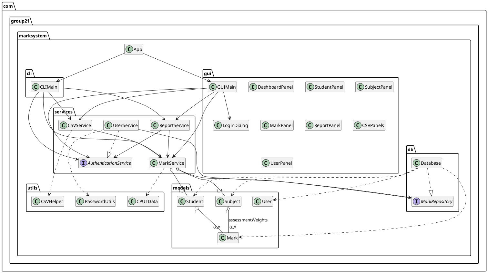

# Console Demo — Core Functionality

**Project:** Marks Administration System (Group 21)
**Scope of this demo:** console application only (the Swing GUI is built but not shown here).

---

## 1. How to run

```bash
mvn clean package
java -jar target/marks-administration-system-1.0.0.jar
```

The demo below uses a throw-away database so the repository data is untouched:

```bash
rm -f /tmp/demo.db
java -Dmarksystem.db=/tmp/demo.db -jar target/marks-administration-system-1.0.0.jar
```

On first start the SQLite database is created at `data/marks.db` (or the path above) and
seeded with CPUT Bellville engineering programmes, 23 students and 123 example marks.

### Demo input (lecturer session)

Annotations after `#` describe the step; they are not typed into the application.

```
1              # CLI mode
lecturer1      # username
pass123        # password
2 3 CIV260S    # Subjects > View Subject Details
0
3 1            # Marks > Enter Marks
253243782      # student
CIV260S        # subject
82 71 90       # Test 1, Test 2, Exam
2 253243782    # Marks > View Student Marks
3 253243782    # Student Mark Report
4 CIV260S      # Subject Mark Report
5              # Missing Marks Report
0
5 2            # CSV > Export
/tmp/demo_marks.csv
0
0              # exit
```

A second run with the same `-Dmarksystem.db=/tmp/demo.db` proves persistence, re-imports
the exported CSV, and shows the lecturer being blocked from HoD-only user management.
A third run logs in as `hod1 / admin123` to list users.

---

## 2. Observed output (abridged)

### 2.1 Login and role-based menu

```
✓ Logged in as: Dr. John Doe (LECTURER)
  Department: Civil Engineering
...
║  1. Student Management                                    ║
║  2. Subject Management                                     ║
║  3. Mark Management                                        ║
║  4. Reports & Analytics                                    ║
║  5. CSV Import/Export                                      ║
║  0. Exit                                                   ║
```

The HoD menu adds `6. User Management (HoD only)`; a lecturer selecting `6` gets
`This feature is available to HoD only.`

### 2.2 Subject definition with assessment weights

```
Code: CIV260S
Name: Structural Analysis 2
Credits: 12
Description: Diploma in Engineering: Civil Engineering - Year 2 (CPUT Bellville)

Assessment Categories:
  Test 1               25.0%
  Test 2               25.0%
  Exam                 50.0%
```

### 2.3 Mark entry, validation and automatic grade calculation

```
── Enter Marks for Hussein Akim - Structural Analysis 2 ──
  Test 1 (Weight: 25%, 0-100, blank = missing):  82
  Test 2 (Weight: 25%, 0-100, blank = missing):  71
  Exam   (Weight: 50%, 0-100, blank = missing):  90

✓ Marks entered successfully.
  Weighted Total: 83.25
  Grade: B+
```

Calculation: `82×0.25 + 71×0.25 + 90×0.50 = 83.25` → `B+`.
Blank/out-of-range input is re-prompted (`✗ Enter a number between 0 and 100.`) instead of
crashing the console; the service layer independently rejects out-of-range scores with
`Mark for '<category>' must be between 0 and 100.`.

### 2.4 Student report and GPA

```
  STUDENT MARK REPORT
Student ID: 253243782
Full Name: Hussein Akim
Program: Diploma in Engineering: Civil Engineering
Year: 2

Subject Code Subject Name                         Score % Grade
CIV260S      Structural Analysis 2                  83.25 B+
CIV270S      Concrete Technology 2                  75.60 B

Cumulative GPA: 3.25 / 4.00
```

### 2.5 Subject statistics and missing-entry flagging

```
Student ID Student Name               Score % Grade
253243782  Hussein Akim                 83.25 B+
258070164  Sipho Ndlovu                 71.75 C+
258543600  Thandiwe Moyo                57.25 F

Statistical Summary:
  Students with marks: 3 of 23
  Class Average: 70.75
  Highest Mark: 83.25
  Lowest Mark: 57.25

  ⚠  Students with missing or absent marks: 20
```

The Missing Marks Report lists every student without a mark (or with an incomplete mark)
per subject, e.g. `253243782  Hussein Akim  NO MARKS ENTERED` for a subject he is not
enrolled in.

### 2.6 CSV export (file I/O)

```
✓ Successfully exported 40 record(s) to /tmp/demo_marks.csv
```

```csv
"StudentID","FirstName","LastName","Email","Program","Year","SubjectCode","SubjectName","Assessment1","Assessment2","Assessment3","Assessment4","Assessment5","WeightedTotal","Grade"
"250660405","Ethan","van Wyk","250660405@mycput.ac.za","Diploma in Engineering: Mechanical Engineering","2","MEC260S","Thermodynamics 2","82","81","70","64","","71.60","C+"
```

The same layout is used by the template, so an exported file can be edited in Excel and
re-imported.

### 2.7 Persistence across restarts

Second run, same database file, no re-entry:

```
── Marks for Hussein Akim ──
Structural Analysis 2 (CIV260S):
  Weighted Total: 83.25
  Grade: B+
```

### 2.8 CSV re-import (round trip)

```
✓ Import complete.
Rows processed: 40
Students created: 0
Students updated: 0
Marks saved: 40
```

### 2.9 Database evidence

```bash
$ sqlite3 /tmp/demo.db ".tables"
marks  settings  students  subject_assessments  subjects  users

$ sqlite3 /tmp/demo.db "select count(*) from students; select count(*) from subjects; select count(*) from marks;"
23
31
123
```

Users are stored with PBKDF2 hashes, and the role is stored separately:

```
lecturer1|LECTURER|pbkdf2$...
hod1|HOD|pbkdf2$...
lecturer2|LECTURER|pbkdf2$...
```

---

## 3. UML class diagram (matches the source tree)



### Class → source evidence → demo evidence

| UML class | File | Responsibility | Demo evidence |
|---|---|---|---|
| `App` | `App.java` | Entry point, chooses CLI/GUI | `Select interface mode: 1. CLI` |
| `CLIMain` | `cli/CLIMain.java` | Console menus, input validation | Login, mark entry, reports |
| `AuthenticationService` | `services/AuthenticationService.java` | Login and account contract | Lecturer blocked from option 6 |
| `MarkRepository` | `db/MarkRepository.java` | Save, load and delete contract | Marks survive restart |
| `GUIMain`, `*Panel`, `*Dialog` | `gui/*.java` | Swing presentation layer | Not shown (console demo) |
| `MarkService` | `services/MarkService.java` | Student/subject/mark rules, grade calculation | Weighted total `83.25` |
| `UserService` | `services/UserService.java` | `AuthenticationService` implementation | `lecturer1` and `hod1` |
| `CSVService` | `services/CSVService.java` | Async import/export, templates | 40 records exported/imported |
| `ReportService` | `services/ReportService.java` | Student, subject, missing and activity reports | Mark report `B+`, class average |
| `Database` | `db/Database.java` | SQLite `MarkRepository` implementation | `.tables`, 23/31/123 row counts |
| `Student` | `models/Student.java` | Student details, map of marks | `Hussein Akim`, 2 marks |
| `Subject` | `models/Subject.java` | Module, credits, assessment weights | `Test 1 25%, Test 2 25%, Exam 50%` |
| `Mark` | `models/Mark.java` | Scores, weighted total, grade, missing flag | `83.25`, `B+` |
| `User` | `models/User.java` | Account, role (`LECTURER`/`HOD`) | `Dr. John Doe (LECTURER)` |
| `CSVHelper` | `utils/CSVHelper.java` | CSV read/write and template layout | Exported header/rows |
| `CPUTData` | `utils/CPUTData.java` | Seed programmes, modules, students | 23 students, 31 subjects |
| `PasswordUtils` | `utils/PasswordUtils.java` | PBKDF2 hashing, legacy verification | `pbkdf2$...` in `users` |

### 3.1 Source evidence (excerpts)

`models/Mark.java` — the domain object behind the weighted result:

```java
public class Mark implements Serializable {
    private String studentId;
    private String subjectCode;
    private Map<String, Double> assessmentMarks; // category -> mark
    private double totalMark;
    private double weightedTotal;
    private Grade letterGrade;
    private LocalDateTime enteredAt;
    private String enteredBy;
    private boolean isMissing; // flag for missing entries

    public enum Grade {
        A_PLUS(90), A(85), B_PLUS(80), B(75),
        C_PLUS(70), C(65), D(60), F(0);
        ...
    }
```

`services/MarkService.java` — business rules and persistence boundary used by the demo:

```java
public boolean enterMarks(String studentId, String subjectCode, Mark mark, String enteredBy) {
    if (mark == null) {
        throw new IllegalArgumentException("Mark is required.");
    }
    validateScores(mark);

    lock.writeLock().lock();
    try {
        Student student = students.get(studentId);
        Subject subject = subjects.get(subjectCode);

        if (student == null || subject == null) {
            return false;
        }

        mark.setEnteredBy(enteredBy);
        mark.alignToCategories(subject.getAssessmentWeights());

        database.saveMark(mark);
        student.addMark(subjectCode, mark);
        return true;
    } finally {
        lock.writeLock().unlock();
    }
}
```

`db/Database.java` — each mark is replaced transactionally for the student/module pair:

```java
public void saveMark(Mark mark) {
    try (Connection conn = connect()) {
        conn.setAutoCommit(false);
        try {
            try (PreparedStatement delete = conn.prepareStatement(
                    "DELETE FROM marks WHERE student_id = ? AND subject_code = ?")) {
                ...
            }
            // INSERT ... VALUES (?, ?, ?, ?, ?, ?, ?)  (batched per category)
            conn.commit();
        } catch (SQLException e) {
            conn.rollback();
            throw e;
        }
    }
}
```

`services/UserService.java` — authentication feeds the role-based menus:

```java
User user;
lock.readLock().lock();
try {
    user = users.get(username);
} finally {
    lock.readLock().unlock();
}

if (user == null || !PasswordUtils.verifyPassword(password, user.getPassword())) {
    return null;
}

lock.writeLock().lock();
try {
    currentUser = user;
} finally {
    lock.writeLock().unlock();
}
return user;
```

---

## 4. Code review notes

* **Layered structure:** `models` (data) → `db` (persistence) → `services` (rules) → `cli`/`gui`
  (presentation). No SQL, CSV parsing or password logic leaks into the UI.
* **Encapsulation:** model fields are private with accessors. SQL stays inside `Database`.
  The console talks to services, and those services talk to `MarkRepository`.
* **Documentation:** public classes and the business methods carry Javadoc, including
  `MarkService.enterMarks`, `Database.saveMark`, `CSVService.importWithReportAsync` and
  every method on `MarkRepository` and `AuthenticationService`. Model getters and setters
  are left uncommented because the names say what they do.
* **Validation in one place:** `MarkService` validates student/subject data, weights
  (must total 100%) and scores (0–100), so the CLI, GUI and CSV import cannot bypass the rules.
* **Thread safety:** `ReadWriteLock`s in `MarkService`/`UserService`, `ConcurrentHashMap`
  collections, `withWriteLock`/`withReadLock` helpers that make multi-step operations
  (CSV import) atomic, and `PRAGMA busy_timeout` on every SQLite connection.
* **Security:** PBKDF2-HMAC-SHA256 with per-password salt for new passwords, legacy SHA-256
  hashes still verified, constant-time comparison, role checks for HoD-only menus.
* **Testing:** 28 JUnit 5 tests across models, services, persistence, CSV, reports and a
  headless Swing test (`mvn test`).
* **Interfaces:** `Database` implements `MarkRepository`. `UserService` implements
  `AuthenticationService`. The console depends on `AuthenticationService` for login and
  user management, and on `MarkRepository` for storage, so those rules are not hard-coded
  into the menus.

---

## 5. Requirements covered by this demo

| Requirement | Evidence |
|---|---|
| Login system / RBAC | Login as `lecturer1`, menu hides user management; `hod1` sees it |
| Data storage | SQLite tables, data survives restart |
| Basic processing | Weighted totals, letter grades, GPA |
| File I/O | CSV template/export/import round trip |
| Missing-entry handling | Missing Marks Report, incomplete marks flagged |
| Reporting | Student, subject, missing-marks and activity reports |
| Validation | Bad year/credits/marks re-prompt; weights must total 100% |
| Code quality | Layered packages, Javadoc, `MarkRepository`, `AuthenticationService`, 28 tests |

This covers well over the required 40–50% of the functional requirements.

---

## 6. Challenges faced and how they were solved

1. **Shared database between CLI, GUI and background CSV import.**
   Every operation opened its own SQLite connection, so concurrent writes could fail or
   interleave. Added `PRAGMA busy_timeout`, write-lock scoping around imports and explicit
   transaction rollbacks. While testing this we also found and fixed a read-to-write lock
   upgrade deadlock in report CSV export.
2. **Editing a subject's assessments corrupted existing marks.**
   Renaming "Exam" to "Final Exam" silently removed 50% of a mark's weight and produced an
   inflated grade. Marks are now realigned to the current categories (`Mark.alignToCategories`)
   on subject edits and when loading from SQLite, with regression tests for the scenario.
3. **Missing marks made grades look better than they were.**
   The weighted total normalised only over the assessments that were entered. It now divides
   by the subject's full weight and sets the missing flag, so an incomplete record cannot pass.
4. **CSV round-trip stability.**
   Column order, computed `WeightedTotal`/`Grade` columns and blank template rows all had to
   survive an export → Excel → import cycle. Columns are matched by header name, assessment
   columns by position, and duplicate student/module rows are counted once.
5. **Password upgrade without breaking existing users.**
   New hashes use PBKDF2, but accounts created by earlier builds used salted SHA-256. The
   verifier detects the version from the stored string and still accepts legacy hashes, and
   malformed hashes now fail authentication instead of throwing.
6. **Teamwork and integration.**
   Eight members worked on separate layers (see `docs/WORK_DIVISION.md`). The main coordination
   challenge was agreeing on the shared schema and service contracts before UI work started;
   we solved it with the layered package structure and integration tests that exercise the
   database, services and CSV engine together.
